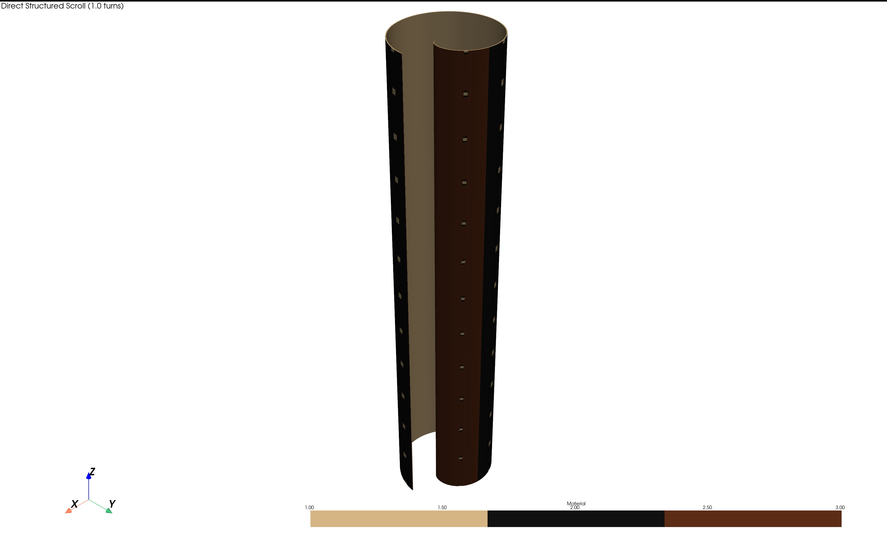
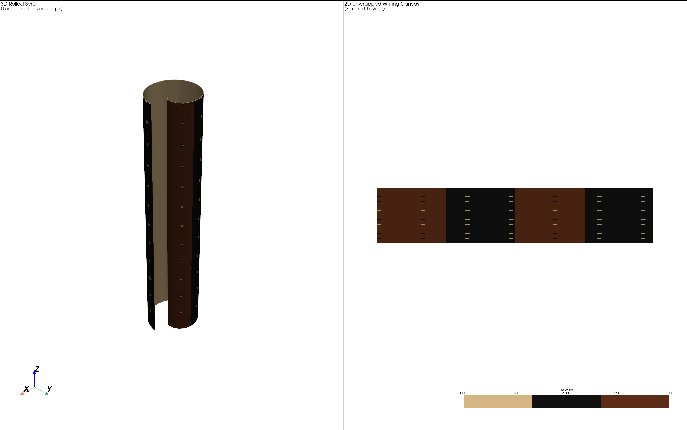
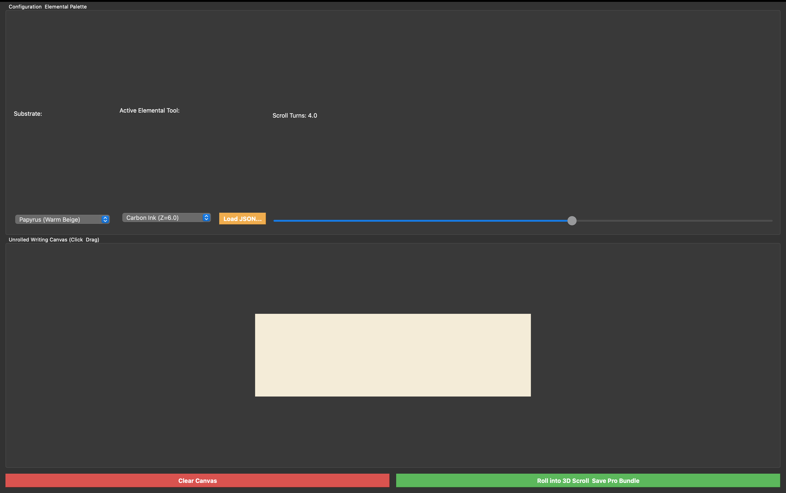
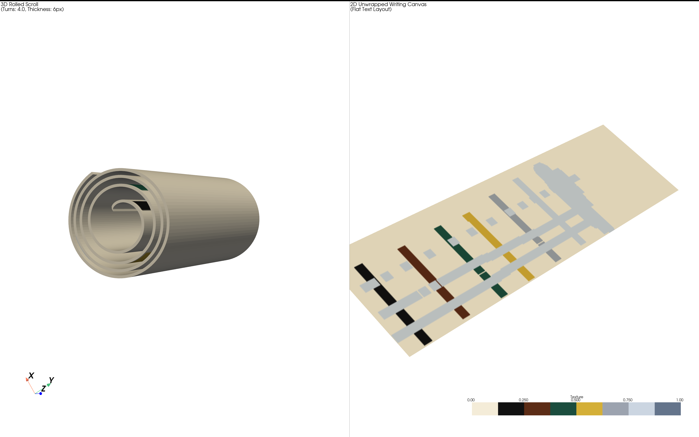
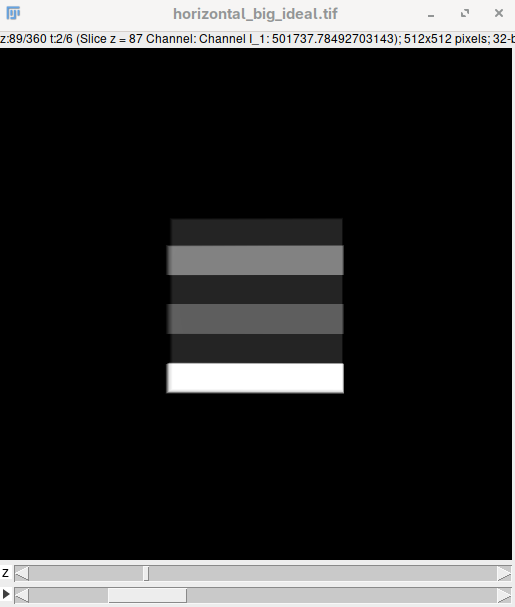
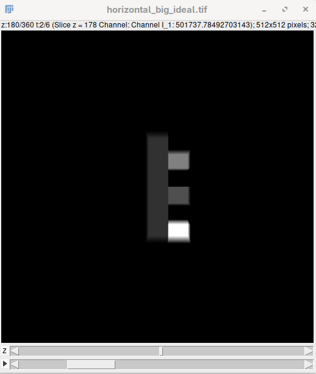

# Making a digital Phantom
I am making a digital phantom.
Packages:
    - numpy
    - trimesh
    - pyvista
    - matplotlib

To generate a papyrus phantom:
```shell
python3 types/papyrus_scroll_with_ink_grids.py --turns 1 --sheet-thickness-px 1
```


To view that phantom:
```shell
python3 view_phantom.py --input papyrus_phantom
```


Phantom Studio Pro:
GUI:


Output View:


## Creating `*.pha` file for CONRAD

In order to create a `*.pha` file for [CONRAD](https://www5.cs.fau.de/conrad/), basic shapes are needed. This is obvious for Ray Tracing. Also, the materials needed for heritage science is different from that of medical purposes. So, the following materials have been added to materials file in [CONRAD](https://www5.cs.fau.de/conrad/):
```text
LampblackInk:  d=1.25  ; F=C8H14O2
IrongallInk:   d=1.45  ; F=FeC10H16O7
Papyrus:       d=0.75  ; F=C6H10O5
Palmleaf:      d=0.85  ; F=C6H10O5
Vellum:        d=1.20  ; F=C5H9NO2
```
The corresponding `XML` for the same can be found [here](heritage-science-artifacts/xml/).

### Generating the phantom
Phantom can be of many types. Here a horizontal stacked chemical block sequence have been created. In order to create this, a `*.txt` file is needed to be created like [this](utils/conrad/material_horizontal_big_thick.txt):
```txt
IRONGALLINK
NONE
LAMPBLACKINK
NONE
CARBON
NONE
```
Then this command is needed to be run (dimensions are in $cm$):
```python
python3 utils/conrad/horizontalboard.py -o $HOME/Documents/work/outputs/phantoms/horizontal_small_thin.pha -b papyrus -m utils/conrad/material_horizontal_big_thin.txt --hwd 10 10 2 --ink-thick 2
```
The `*.pha` file looks like this after generation:
```txt
Phantom "horizontal-big"

// Flat Board Horizontal Bars Phantom using file: utils/conrad/material_horizontal_big.txt

// Base Material: PAPYRUS | Board [Width(dx): 10.0, Depth(dy): 2.0, Height(dz): 10.0] (cm)

// --- Base Substrate Board ---
{[ Box: x=0.0; y=0.0; z=0.0; dx=10.0; dy=2.0; dz=10.0;]; formula = H20; rho = PAPYRUS; priority = 1;}
// --- Horizontal Material Strips (Top to Bottom) ---
{[ Box: x=0.0; y=2.0000; z=4.1667; dx=10.0000; dy=2.0; dz=1.6667;]; formula = H20; rho = IRONGALLINK; priority = 2;}
{[ Box: x=0.0; y=2.0000; z=0.8333; dx=10.0000; dy=2.0; dz=1.6667;]; formula = H20; rho = LAMPBLACKINK; priority = 2;}
{[ Box: x=0.0; y=2.0000; z=-2.5000; dx=10.0000; dy=2.0; dz=1.6667;]; formula = H20; rho = CARBON; priority = 2;}
```

### Output from CONRAD
The CONRAD outputs a stacked sample projection:




